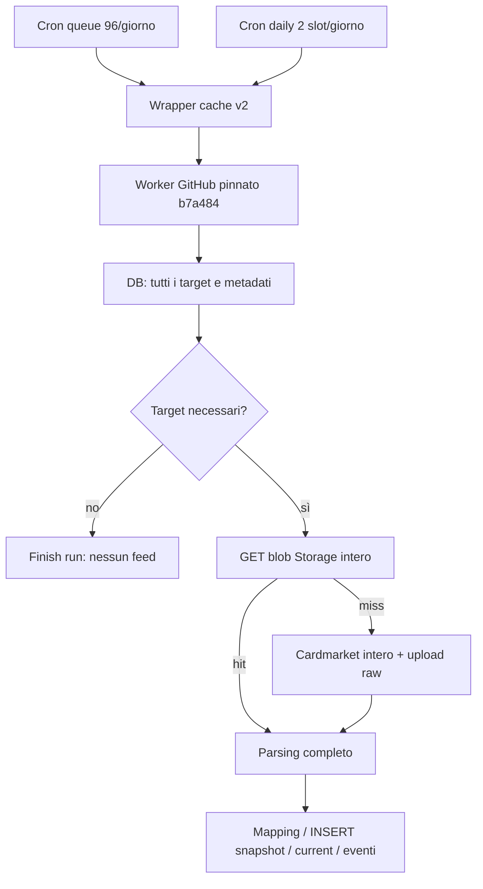
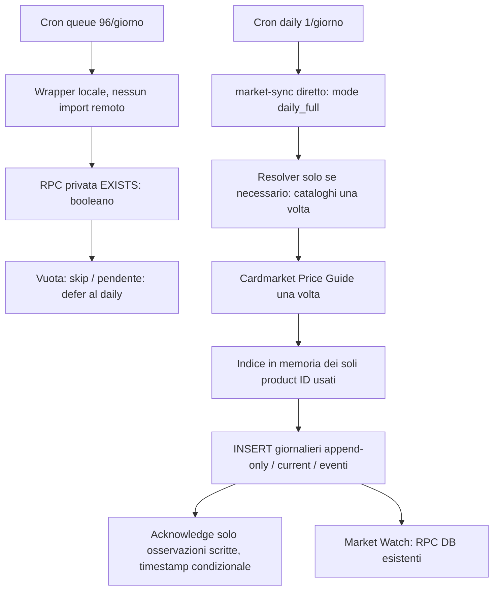

# Market Feed Egress Hardening — 4 ottobre 2026

## Esito e perimetro

Implementazione locale completata; produzione consultata solo in lettura attraverso il plugin Supabase. Nessun deploy, commit/push, modifica cron/secrets, scrittura DB live, download dei blob reali o cancellazione Storage. Retention/cleanup DB esclusi e preservati.

**SAFE TO DEPLOY = NO per un deploy isolato/immediato.** Il wrapper nuovo rinvia sempre al daily: sostituirlo mentre il cron daily punta ancora al wrapper fermerebbe gli aggiornamenti. Serve il cutover coordinato sotto, con verifica del daily nel budget reale Edge. Le prove offline sono positive; una verifica browser aggiuntiva del bootstrap guest resta fallita, distinta dai 23 test Market passati. Non presentiamo questa verifica come verde.

## 1. Root cause più probabile, con evidenze

Il percorso cron attuale aggira il worker live `market-sync` v57: entrambi i cron chiamano `market-refresh-queue-cached` v2, che importa il worker dal commit GitHub `b7a484c5ef92cd0bd834f1e7f59d233189a7bfd1`. Aggiornare solo `market-sync` non corregge questo percorso.

**Egress anche senza feed:** il worker pinnato legge tutte le pagine di `market_sync_targets`, inclusi `provider_metadata` e candidati, PRIMA di filtrare la coda. Audit aggregato: 3.133 target, 0 in coda, **6.809.998 byte** sommando `row_to_json` delle righe. È una stima del payload non compresso, non una misura della fattura o del traffico HTTP compresso. Il vecchio percorso può quindi trasferire ~6,81 MB DB→Edge anche a coda vuota. Su 48 ore disponibili sono stati osservati 15 run riusciti con zero target e un run fallito; questi dati non ricostruiscono il consumo del ciclo di fatturazione.

**Amplificazione con lavoro pendente:** anche un solo target autorizzato richiede l'intero Price Guide; i target da risolvere richiedono anche i cataloghi. Il wrapper legge il blob completo da Storage a ogni HIT. Il caching elimina il download da Cardmarket, non il trasferimento Storage→Edge. Su MISS scarica Cardmarket e salva una copia raw con `tee()`/`waitUntil`; non esiste una cache compatta persistente. Il vecchio `request()` ammette fino a tre tentativi per URL.

La documentazione distingue egress Database, Storage ed Edge e precisa che anche il cached egress ha una quota: [Supabase Manage Egress](https://supabase.com/docs/guides/platform/manage-your-usage/egress). Un HIT del wrapper applicativo NON dimostra un HIT CDN né un trasferimento gratuito. I numeri sotto descrivono flussi teorici, senza sommare arbitrariamente gli stessi byte in più categorie di billing.

## 2. Pipeline prima/dopo

Configurazione live letta, senza esporre gli header segreti:

| Cron | Schedule | Endpoint | Payload rilevante |
|---|---|---|---|
| `fpt-market-refresh-queue` | `5,20,35,50 * * * *` | `market-refresh-queue-cached` | `refreshQueue:true` |
| `fpt-market-sync-daily` | `0 1,2 * * *` | `market-refresh-queue-cached` | `pricesOnly:true`, source `daily_price_refresh` |

Il nome daily non implica una sola esecuzione: attualmente sono due slot al giorno. Non passa `scheduled:true`; quindi quel payload non usa il filtro orario 03:00 Europe/Rome del worker.

Prima del feed il worker effettua `begin_market_provider_sync` e la paginazione target. Il ramo resolver legge anche `card_printings`, nomi canonici YGOPRODeck e registro varianti; dopo il catalogo salva mapping/shadow, poi legge prezzi. Dopo il feed: snapshot INSERT a batch 250, acknowledgement dei flag e `finish`. La nuova queue non apre run, non legge cataloghi/printings/metadati e non scrive flag.

## 3. Inventario fetch pesanti

Sorgenti dei tre wrapper live conservati in `docs/audit-snapshots/market-egress-2026-10-04/` per confronto; non sono entrypoint da distribuire.

| File / funzione | Attivazione e frequenza precedente | Dimensione | Rischio / necessità |
|---|---|---:|---|
| `market-sync/index.ts`, `rpcPages` → `market_sync_targets` | Ogni `syncProvider`, anche queue vuota; circa 7 pagine per 3.133 target | ~6,81 MB JSON/lettura | Evitabile nel polling; resta nel daily |
| stesso file, `loadPrices` → `request` | Almeno un mapping autorizzato; una lettura normale per istanza/run, non per target | Price Guide max osservato 17.404.955 B | Evitabile nella queue; necessario nel daily finché upstream offre bulk |
| stesso file, `loadCatalog` → `request` | Resolver/full; una lettura di ciascun catalogo, prima del mapping | Singles 14.666.305 B; nonsingles 446.337 B | Evitabile quando tutti i mapping sono correnti; necessario se serve il resolver |
| `market-refresh-queue-cached` v2, `cachedFetch` | Ogni GET bulk del worker; cache solo per data, nessuna memoization per invocazione | Blob completo a ogni HIT | Storage→Edge ripetuto; eliminato nel nuovo percorso |
| stesso wrapper, `cacheUpload` | Ogni MISS: stream Cardmarket biforcato al parser e Storage | Stesse dimensioni | Raw giornaliero non necessario dopo parsing nel nuovo percorso |
| `market-sync-cache-canary` v1, `cachedFetch` | Solo invocazioni esplicite; import pinnato `4d56cea57a7988b2c2b8af69ba55f7c0605ddcad` | Stessi bulk | Non è uno dei due endpoint cron osservati; evitare uso ricorrente |
| `market-feed-cache-canary` v1, `cachedProbe` | POST admin, kind price/catalog/nonsingles | MISS: file completo verso Storage; HIT: cancella il body dopo gli header | HIT non va assunto a 0 byte fisici: possibile prefetch del trasporto; diagnostica manuale soltanto |
| worker, `withCanonicalCardNames` | Resolver, chunk di ID verso YGOPRODeck | Dipende dai target; non misurato live | Residuo daily/admin, non queue |

Il vecchio wrapper non propaga il timeout del worker al GET Storage; il MISS passa il segnale al fetch upstream. Le mappe `prices`/`catalog` sono per istanza, non persistono tra invocazioni. `loadPrices` filtra durante lo streaming ma questo riduce la memoria trattenuta, non i byte del file ricevuto.

## 4. Egress teorico prima/dopo

MB/GB decimali, 30 giorni, 2.880 invocazioni queue. Non sono consumi fatturati osservati.

| Flusso ipotizzato a ogni queue run | MB/run arrotondati | GB/30 giorni | Con massimo file osservato |
|---|---:|---:|---:|
| Price Guide | 17,4 | 50,112 | 50,126 GB |
| Singles | 14,7 | 42,336 | 42,239 GB |
| Nonsingles | 0,45 | 1,296 | 1,285 GB |
| Tutti e tre | 32,55 | 93,744 | 93,651 GB |
| Target DB, anche queue vuota | 6,809998 | 19,613 | Misura JSON aggregata |

Worst case normale queue: ~113,36 GB/mese tra target DB e tre feed, esclusi retry, altri RPC, upload e due daily attuali. Non è un limite superiore con retry. Daily attuale, se tutti i 60 slot mensili completano il ramo prezzi: ulteriori ~1,044 GB raw Price Guide e ~0,409 GB JSON target.

Expected case non determinabile senza distribuzione storica della coda e report Usage: con `p` frazione di run che leggono prezzi e `c` frazione che leggono cataloghi, il modello queue è **19,613 + 50,112p + 43,632c GB/mese** prima di compressione, retry e altre risposte. Lo stato osservato ora corrisponde a p=c=0: feed zero, ma lettura target comunque ampia. Non attribuiamo automaticamente il superamento quota ai blob.

Dopo:

- Queue vuota: DB JSON `false` = 5 B; risposta Edge = 77 B; **0 B feed, 0 B Storage**. Circa 82 B di corpi risposta totali, più header/TLS/richiesta/log. Budget prudenziale: pochi KB/invocazione, da misurare sul trasporto.
- Queue con 1 o molti target: DB JSON `true` = 4 B; risposta Edge = 86 B; **0 B feed, 0 B Storage**, nessun acknowledgement. Circa 90 B di corpi risposta. A 2.880 run, 0,24–0,26 MB/mese di soli corpi risposta.
- Daily: Price Guide ~17,4 MB una volta; altri ~15,15 MB soltanto se serve il resolver. **17,4–32,55 MB/job**, 522–976,5 MB/30 giorni di ingresso raw Cardmarket→Edge; **0 MB di raw Storage letto** nel percorso nuovo.
- Daily DB: il percorso in due fasi può leggere i target due volte, ~13,62 MB/giorno con i dati attuali (~409 MB/mese non compressi), più eventuali printing/mapping. È traffico residuo reale da osservare, non zero. Nessun full feed viene restituito al chiamante.

## 5. Implementazione e scelta preprocessing

Scelta P0: **deferral al daily**, esplicitamente previsto dal task. Il daily già crea una `Map` dei soli product ID autorizzati (~3k mapping, numero di ID non necessariamente identico) e produce snapshot/current DB normalizzati. Riutilizziamo questa proiezione persistente per la UI, senza inventare nuove osservazioni dalla cache di ieri.

| Opzione | Valutazione |
|---|---|
| A: tabella compatta per product ID | Migliore estensione futura se serve davvero servire nuove mapping prima del daily. Impone generazione/source_updated_at, pubblicazione atomica e nuova policy. Oggi duplica parte del current layer e non offre dati più freschi del daily. Non introdotta. |
| B: shard Storage | Riduce payload mirati ma mantiene letture Storage, manifest/generazioni e invalidazione; complessità non giustificata per pochi utenti. Non scelta. |
| C: indice soli ID usati | Scelto in memoria nel daily con persistenza tramite snapshot/current già esistenti. Nessun nuovo blob/KV da mantenere. Una mapping nuova senza prezzo resta pending, non può far partire un bulk dal polling. |

Modifiche effettive:

- `supabase/functions/market-refresh-queue-cached/index.ts`: nuovo entrypoint locale senza import GitHub/intercettazione fetch/Storage. Auth secret invariata; una RPC boolean; errore chiuso con 503, senza fallback.
- `supabase/functions/market-sync/index.ts`: stessa policy queue; `mode:daily_full` esplicito; richieste generiche senza consenso bulk respinte. `dryTargetPrintingIds`/`canaryPrintingIds` richiedono `allowFullFeed:true`. I job amministrativi espliciti `resolvePending`, variant canary/price shadow conservano il loro contratto; non sono polling di prezzo.
- Nel provider Edge ogni URL bulk può essere richiesto una volta per istanza/invocazione, anche dopo errore HTTP o body parziale. Nessun retry bulk automatico. Recovery tramite un nuovo job esplicito.
- Daily conserva INSERT con chiave `<mapping_id>:<YYYY-MM-DD>` e `resolution=ignore-duplicates`. Nessun UPDATE ai valori snapshot. Flag refresh rimossi solo per mapping con osservazioni scritte; predicato con ID **e timestamp originale** protegge richieste concorrenti. Batch acknowledgement max 100; errori/prezzi assenti restano pending.
- `supabase/manual/market-feed-queue-probe.sql`: SQL preparato e non applicato; boolean `EXISTS`, niente metadata, `search_path` chiuso, privilegi solo service_role. Replica anche la coda implicita dei mapping resolved/manual senza snapshot Cardmarket. Indici live verificati: PK printing, mapping printing/provider e snapshot printing/provider esistono. Il SELECT equivalente live concorda con la vecchia coda (`false`/`false`).
- `scripts/market-feed-hardening-smoke.mjs`, `package.json`: nuova suite offline e comando `test:market-feed-hardening`.
- `scripts/market-feed-egress-audit.sql`: audit ripetibile READ ONLY con aggregati e metadati.
- Questo report e le tre copie sorgente dei wrapper live sotto `docs/audit-snapshots/market-egress-2026-10-04/`.

Le altre modifiche già presenti nel worktree, compresi retention e frontend, non sono parte di questo delta.

## 6. Osservabilità

JSON strutturato: `market_sync_feed_bytes`, `market_sync_storage_bytes_read`, `market_sync_cache_hit`, `market_sync_cache_miss`, `market_sync_targets`, `market_sync_feed_skipped`, `market_sync_mode` (`daily_full`/`queue_targeted`). Queue vuota emette esattamente `market_queue_empty_skip_feed`; coda presente `market_queue_deferred_until_daily`.

Il probe è volutamente EXISTS: `market_sync_targets` vale 0/1 con `targets_are_lower_bound:true`, non pretende di contare tutta la coda. Nel daily viene emesso il conteggio effettivo dei target del ciclo.

I feed sono misurati nel reader, con record started/progress/complete/failed/cancelled correlati da `egress_id` e filename. I contatori sono **cumulativi per feed**: usare l'ultimo/massimo, non sommare progress. Il daily diretto emette `cache_source:bypass`; un eventuale response marcato `x-market-cache:hit` conta anche i byte Storage. HIT non vale zero. Un isolate ucciso può lasciare un conteggio parziale: assenza di complete non dimostra 0 byte. Sono byte decodificati consumati, non contabilità HTTP/CDN/TLS.

## 7. Storage: audit e proposta separata

Bucket `market-feed-cache` privato. Metadati osservati:

| Raw | Oggetti | Byte totali | Prima/ultima creazione UTC |
|---|---:|---:|---|
| Price Guide | 20 | 347.714.396 | 09–28 settembre 2026 |
| Singles | 10 | 146.640.806 | 09–18 settembre 2026 |
| Nonsingles | 10 | 4.461.543 | 09–18 settembre 2026 |
| Totale | 40 | **498.816.745** | ~498,82 MB |

I path sono data Europe/Rome, con giorno precedente prima delle 03:00. I wrapper cercano soltanto quel giorno; non riusano il catalogo valido di ieri e non hanno cleanup. Nessun meccanismo di retention è stato trovato nei tre sorgenti; non abbiamo assunto che questi metadati dimostrino tutti i job esterni possibili.

Proposta, nessuna cancellazione eseguita: raw prezzi massimo 2–3 giorni solo per debug/rollback; catalogo ultima copia valida verificata, conservando quella precedente durante la sostituzione; eventuale cache processed futura generazione corrente + backup. Dopo il parsing il raw prezzo non è necessario al writer/current/UI. Il percorso nuovo non crea altri raw e non consulta quelli vecchi. La capacità Storage e l'egress restano metriche distinte.

## 8. Frontend residual egress

Audit rapido, nessun redesign/modifica frontend:

- `MarketWatchController.load()`: in-flight dedup; owned page, extra, summary, movers e anomalies. Owned è paginata realmente a 60; extra deck/watchlist non paginata; summary restituisce aggregati ma può contenere molti `catalogPriceFloor`. Confirmation metadata lazy.
- `marketDashboardMovers`: una RPC per load. Featured: fino a 3 chiamate `marketPriceHistory(id,365)`, cache in memoria invalidata dal nuovo `lastSync`. Una corsa fra movers e summary può invalidare history appena caricata: residuo, non ottimizzato qui.
- Storico: SQL restituisce una riga per provider/tipo/giorno per le serie primarie, non tutti i tipi prezzo. Finestra 365 giorni può includere 366 date UTC parziali; massimo teorico due serie = 732 righe/carta. Tre grafici: fino a 2.196 righe, circa 0,22–0,33 MB se 100–150 B/riga (stima, non payload live misurato).
- Row history: N+1 solo per righe visibili (IntersectionObserver, margine 200 px), intervallo 30 giorni, cache/in-flight per printing. Sessanta carte completamente percorse possono provocare sessanta RPC; dettaglio cambia intervallo con richiesta dedicata.
- Refresh 15 minuti solo pagina Market visibile, utente presente, non route share. Non è 96 richieste/giorno per ogni browser chiuso/inattivo.
- Shared Collection guest: una RPC `getCollectionShare`, elenco completo, “Mostra altre” è paginazione UI; niente history Market per riga e niente polling Market sul guest. Collezioni grandi/immagini possono restare un contributore significativo.

Il frontend non è a costo zero, ma non scarica i raw Cardmarket. Non abbiamo misurato sessioni live o fatture per attribuirgli una percentuale. Il polling backend dei target da solo spiega un rischio molto maggiore anche senza utenti aperti.

## 9. Test e limiti

**23/23 suite `scripts/market-*-smoke.mjs` PASS**, inclusi browser mobile, resolver/mapping, variant/admin panels, current-layer/cutover, dashboard, paginazione/loading e strict retention. La suite retention esegue PostgreSQL/WASM con fixture: INSERT anomalo, evento nuovo, ID previous/current distinti, avanzamento current, duplicato giornaliero ignorato, trend/reference history, riferimenti protetti. Nessuna eliminazione di dati reali.

Nuova suite: entrambi gli HTTP entrypoint, coda 0/1/3000 (un booleano, zero feed/scritture), auth, errore RPC senza fallback; daily parser/writer reali con 1/3/100 target e un solo feed; ramo resolver con due cataloghi + un Price Guide; errori HTTP/rete/body senza secondo bulk; byte HIT/MISS non gratuiti; acknowledgement solo dopo scrittura. PostgreSQL reale via PGlite verifica il probe, sua riapplicazione, missing mapping/price, game/monitoring e rifiuto anon/authenticated.

Altri quattro test PASS: catalog-market-names, dashboard-movers, dashboard-trends-browser, collection-share-guest. Totale **27 PASS**. Il controllo aggiuntivo `collection-share-bootstrap-guard-smoke.mjs` **FAIL**: dopo 800 ms e anche nel controllo diagnostico a 5 s, body già marcato share ma ancora splash e nessuna `.share-guest-shell`. Nessuna shell privata esposta nel risultato. Causa del bootstrap non determinata in questo task; nessuna modifica di questi file per mascherare il fallimento.

Non testati con scritture live: deploy Deno reale, piano cron coordinato, parsing bulk completo sotto limiti CPU/tempo Free. La suite Node esegue il worker TypeScript rimuovendo i tipi, non sostituisce un deploy di staging. Non è stato scaricato un feed reale per “misurare” consumando la quota.

## 10. Rollout proposto, da autorizzare separatamente

1. Salvare versioni correnti e configurazione cron; validare in staging worker, RPC e durata del daily con volume rappresentativo. Risolvere/qualificare il fallimento bootstrap guest prima di un gate globale verde.
2. In finestra controllata sospendere i due cron per evitare invocazioni durante il cambio; non modificare secrets.
3. Applicare **solo** `supabase/manual/market-feed-queue-probe.sql`, verificare booleano, privilegi e latenza. Non applicare migration/cleanup retention.
4. Distribuire `market-sync` locale direttamente, preservando secret gate/configurazione JWT; nessun wrapper/pin remoto nel daily.
5. Cambiare `fpt-market-sync-daily` in **`15 3 * * *` UTC**, una sola esecuzione/dì, endpoint `/functions/v1/market-sync`, body `{"mode":"daily_full"}` e header segreto esistente. Verificare timezone del cron; questo corrisponde alle 05:15 estive / 04:15 invernali italiane. Il mode esplicito non usa il vecchio doppio slot DST.
6. Eseguire/verificare un daily controllato: massimo un Price Guide, cataloghi solo se servono, snapshot/current/eventi corretti, pending non persi. Evitare un secondo daily automatico nello stesso giorno durante la verifica.
7. Solo dopo il daily funzionante distribuire il nuovo `market-refresh-queue-cached`. Mantenere `5,20,35,50 * * * *` e `{"refreshQueue":true}`; riattivare il polling. Il wrapper non deve più servire da endpoint daily.
8. Verificare coda vuota/presente con log 0 feed/0 Storage e risposta minima, osservare Usage Database/Storage per 24–48 ore. Se il probe supera il budget DB, ridurre polling a orario mentre si ottimizza; non ripristinare i bulk ogni 15 minuti.

Non aggiungere schedule ai canary cache archiviati. Gli strumenti admin bulk sono espliciti e costosi: limitare l'uso durante l'osservazione. Nuovi target/prezzi possono attendere il daily; errori upstream richiedono recovery esplicita e mantengono il pending.

## 11. Rollback

In caso di problema lasciare il polling disabilitato o il wrapper economico; non ripristinare automaticamente il wrapper Storage sul cron frequente. Ripristinare il worker v57 salvato e un daily diretto compatibile (`pricesOnly:true` per il vecchio worker; resolver manuale esplicito se necessario). Non cambiare modello snapshot. Il nuovo probe può rimanere inutilizzato: nessun dato applicativo da migrare/ripristinare. Archivi v2/v1 disponibili per confronto, non come rollback automatico del traffico ogni 15 minuti. Nessun rollback Storage/retention necessario perché non sono stati modificati.
